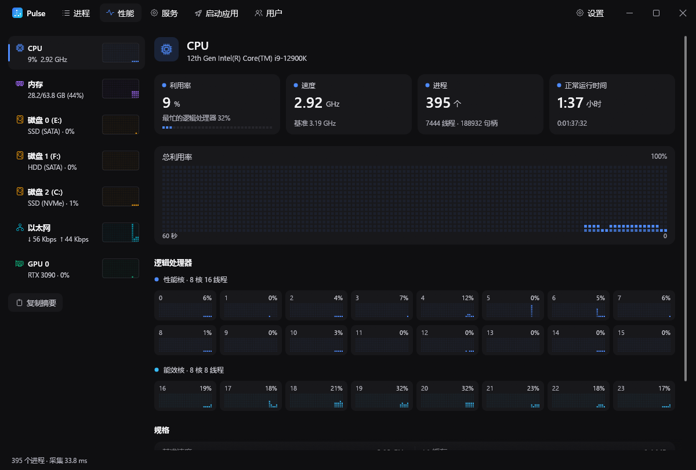

<p align="center">
  
  <h1 align="center">Pulse</h1>
  <p align="center">
    <a href="https://github.com/Jannchie/pulse/actions/workflows/ci.yml"></a>
  </p>
  <p align="center"><a href="README.md">中文</a> · English</p>
  
</p>

Pulse is a replacement for the Windows Task Manager, written natively in Rust with egui. It ships as a single executable and needs no installation. The interface is in Chinese.

Compared with the built-in Task Manager:

- Search covers process names, descriptions, command lines and paths, with fuzzy matching, typo tolerance and `:port` lookup.
- Per-process GPU usage and VRAM, network traffic, listening ports and CPU time.
- The performance page shows NVMe health (remaining life, power-on hours, data written), memory modules and performance/efficiency cores.
- Near-zero CPU while idle: the window repaints only when data or input changes.

## Install

Download `pulse-<version>-windows-x64.exe` from [Releases](https://github.com/Jannchie/pulse/releases) and run it. Requires Windows 10 or 11 (x64).

## Quick start

```powershell
pulse.exe :5173        # opens with the process listening on port 5173 selected by the filter
```

Command-line arguments become the initial search. Right-click a process to end, suspend, change priority or affinity, create a dump file or open its location.

## Common tasks

- **Find what holds a port**: search `:8080`, or enable "监听端口" (listening ports) in the toolbar.
- **Combine terms**: space-separated terms must all match; `!chrome` excludes, `^node` matches a prefix, `'vite` matches exactly.
- **End a process tree**: right-click a process and choose "结束进程树"; children are ended before the parent.
- **Replace Ctrl+Shift+Esc**: enable "替换任务管理器" under Settings → System; Windows then launches Pulse whenever Task Manager is requested.

These features require running as administrator (the toolbar offers a restart as administrator): per-process network statistics, modified/standby memory, ending system processes, starting and stopping services, editing startup items for all users, and replacing Task Manager.

## Build from source

Requires Rust 1.88 or later and the MSVC toolchain (used to compile the executable's icon resource).

```powershell
cargo build --release   # output: target\release\pulse.exe
```

To publish a release, bump the version in `pulse/Cargo.toml` and push a matching tag (for example `v0.2.0`); CI builds it and creates the release.
