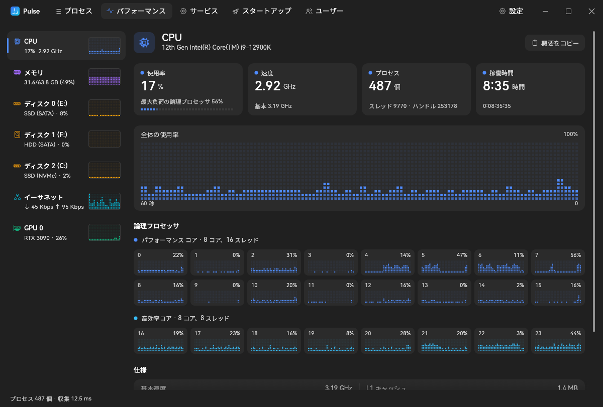

<p align="center">
  
  <h1 align="center">Pulse</h1>
  <p align="center">
    <a href="https://github.com/Jannchie/pulse/actions/workflows/ci.yml"></a>
  </p>
  <p align="center"><a href="README.md">中文</a> · <a href="README.en.md">English</a> · 日本語</p>
  
</p>

Pulse は Windows タスク マネージャーの代替となるアプリケーションで、Rust と egui によるネイティブ実装です。インストーラー版と、インストール不要の単一実行ファイル (ポータブル版) を提供しています。表示言語は日本語、簡体字中国語、英語に対応しており、既定では Windows の表示言語に従います。「設定 → 外観」で変更できます。

標準のタスク マネージャーとの主な違いは次のとおりです。

- ウィンドウを閉じても通知領域で実行を続け、アイコンをクリックすると再び開きます。サインイン時に通知領域で起動するように設定できます (管理者として有効にすると、最上位の特権で実行するタスクとして登録され、UAC は表示されません)。Pulse をもう一度起動すると、実行中のウィンドウが表示されます。
- 「使用状況」ページでは、各プログラムが前面にあった時間と入力していた割合を記録します (5 分以上離席している間や画面のロック中は数えません)。日・週・月・年・すべて、過去 24 時間・7 日間・30 日間・365 日間、またはカレンダーで選んだ期間で表示でき、過去 1 年のヒートマップも表示します。プログラムはゲーム、開発、仕事効率化、クリエイティブ、コミュニケーション、ブラウズ、メディア、システム・ツールに自動で分類され、カテゴリをクリックするとそのカテゴリだけを表示します (ゲームごとのプレイ時間など)。ゲームは Windows ゲーム バーの既知のゲーム一覧、Steam / Epic / GOG のライブラリ フォルダー、exe の隣にあるゲーム エンジンのファイルから、その他のカテゴリはよく使われるアプリの一覧から判定します。アプリの横にあるカテゴリをクリック (または右クリック) して変更でき、変更は `%APPDATA%\Pulse\categories.ini` に保存されます。1 分ごとの全体のリソース使用量と使用量の多いプロセスも記録します。データはこの PC (`%LOCALAPPDATA%\Pulse\history.db`) にだけ保存されます。
- プロセス名、説明、コマンド ライン、パスを対象に検索でき、あいまい一致、入力ミスの許容、`:ポート番号` による使用元の特定に対応しています。
- プロセスごとに GPU 使用率と VRAM、ネットワーク通信量、リッスン ポート、CPU 時間を表示します。
- 同じ名前のプロセスが何をしているかを表示します。node.exe は「vite · プロジェクト名」「pnpm dev · プロジェクト名」のように表示され、Python、Java、.NET も同様です。Chrome、Edge、VS Code などの子プロセスにはレンダラー、GPU プロセス、ネットワーク サービスといった役割を、vmmemWSL には実行中の WSL ディストリビューションを表示します。
- パフォーマンス ページでは、NVMe の正常性情報 (推定残り寿命、電源投入時間、総書き込み量)、メモリ モジュール、パフォーマンス コアと高効率コアの情報を確認できます。
- アイドル時の CPU 使用率はほぼゼロです。データまたは入力に変化があったときにのみ再描画します。

## インストール

[Releases](https://github.com/Jannchie/pulse/releases) から次のいずれかをダウンロードしてください。動作環境は Windows 10 または 11 (x64) です。

- **インストーラー (推奨)**: `pulse-<バージョン>-windows-x64-setup.exe` は、すべてのユーザー向けに `C:\Program Files\Pulse` へインストールし、スタート メニューにショートカットを作成します。アンインストールは「設定 → アプリ」から行えます。
- **ポータブル版**: `pulse-<バージョン>-windows-x64.exe` はダウンロードしてそのまま実行でき、インストール情報を書き込みません。

Pulse は起動時と 1 日 1 回、新しいバージョンを確認し、見つかった場合はタイトル バーでお知らせします。ダウンロード、検証、インストールは確認した後にのみ行われます。自動確認は「設定 → 全般」でオフにできます。

## クイック スタート

```powershell
pulse.exe :5173        # ポート 5173 を使用しているプロセスで絞り込んだ状態で起動します
```

コマンド ライン引数は検索語の初期値になります。プロセスを右クリックすると、終了、中断、優先度と関係の設定、ダンプ ファイルの作成、ファイルの場所を開く操作を実行できます。

## 主な使い方

- **ポートの使用元を調べる**: `:8080` で検索するか、ツール バーの「リッスン ポート」を有効にして、TCP ポートをリッスンしているプロセスだけを表示します。
- **ファイルの使用元を調べる**: ファイルやフォルダーのパスを検索ボックスに貼り付けるか、ツール バーの「ファイルの使用元」でファイルを選ぶと、それを使用しているプロセス (ファイルを開いている、DLL を読み込んでいる、作業ディレクトリがフォルダー内にある) だけが表示され、そのまま終了できます。
- **検索語を組み合わせる**: 空白で区切った語はすべて一致する必要があります。`!chrome` は除外、`^node` は前方一致、`'vite` は完全一致を表します。
- **プロセス ツリーを終了する**: プロセスを右クリックして「プロセス ツリーの終了」を選択します。子プロセスを先に終了し、その後に親プロセスを終了します。
- **Ctrl+Shift+Esc を置き換える**: 「設定 → システム」で「タスク マネージャーを置き換える」を有効にすると、Windows がタスク マネージャーを起動する際に Pulse が起動します。

次の機能を使用するには管理者として実行する必要があります (ツール バーの「管理者として再起動」から再起動できます): プロセスごとのネットワーク統計、変更済みメモリとスタンバイ メモリの表示、システム プロセスの終了、サービスの開始と停止、全ユーザーのスタートアップ項目の変更、タスク マネージャーの置き換え。

## ソースからのビルド

Rust 1.88 以降と MSVC ツールチェーン (実行ファイルのアイコン リソースのコンパイルに使用) が必要です。

```powershell
cargo build --release   # 出力先: target\release\pulse.exe
```

新しいバージョンをリリースするには、`pulse/Cargo.toml` のバージョンを更新し、同じ名前のタグ (例: `v0.2.0`) をプッシュします。CI がビルドを行い、リリースを作成します。

## ライセンス

[MIT](LICENSE)。著作権表示と許諾表示を残せば、商用を含めて自由に使用、改変、再配布できます。依存ライブラリの [nucleo-matcher](https://crates.io/crates/nucleo-matcher) は MPL-2.0 で、ソース コードは crates.io で入手できます。
