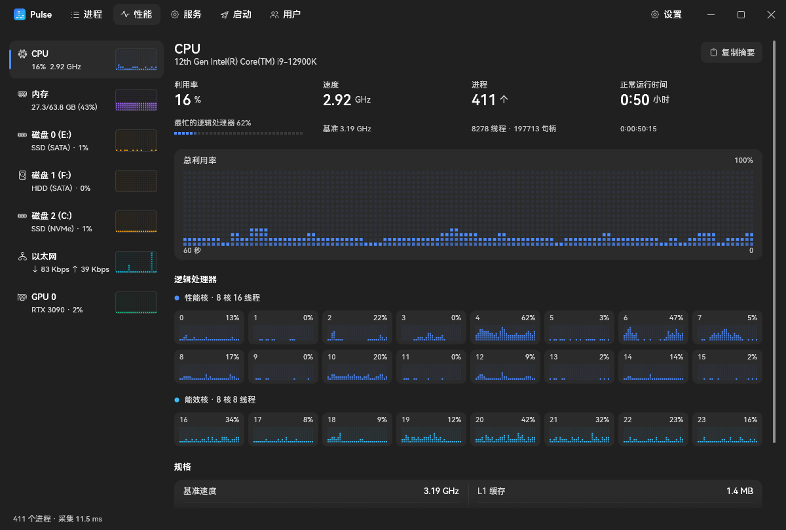

<p align="center">
  
  <h1 align="center">Pulse</h1>
  <p align="center">
    <a href="https://github.com/Jannchie/pulse/actions/workflows/ci.yml"></a>
  </p>
  <p align="center">中文 · <a href="README.en.md">English</a> · <a href="README.ja.md">日本語</a></p>
  
</p>

Pulse 是 Windows 任务管理器的替代品，使用 Rust 与 egui 原生实现，提供安装程序与免安装的单个 exe。界面支持简体中文、英文与日文，默认跟随 Windows 显示语言，可在「设置 → 外观」中切换。

与系统任务管理器相比：

- 「统计」页记录各程序在前台的时长和键盘输入的占比（离开超过 5 分钟、锁屏时不计），可以按日、周、月、年、全部，最近 24 小时、7 天、30 天、365 天，或在日历上自选区间查看，附最近一年的热力图；每分钟还会记下整体占用和占用最高的进程。数据只保存在本机（`%LOCALAPPDATA%\Pulse\history.db`）。
- 搜索覆盖进程名、描述、命令行和路径，支持模糊匹配、拼写容错和 `:端口` 查找占用者。
- 逐进程显示 GPU 利用率与显存、网络流量、监听端口和 CPU 时间。
- 认得出同名进程各自在做什么：node.exe 显示为「vite · 项目名」「pnpm dev · 项目名」，Python、Java、.NET 同理；Chrome / Edge / VS Code 等的子进程标出渲染进程、GPU 进程、网络服务；vmmemWSL 标出运行中的 WSL 发行版。
- 性能页提供 NVMe 健康信息（剩余寿命、通电时间、累计写入）、内存条与大小核信息。
- 空闲时几乎不占用 CPU：只在数据或输入变化时重绘。
- 关闭窗口后留在通知区域继续运行，单击图标重新打开；可以设为登录时直接在通知区域启动（以管理员身份开启时用计划任务以最高权限启动，不弹 UAC）。再次启动 Pulse 会唤出已在运行的窗口。

## 安装

从 [Releases](https://github.com/Jannchie/pulse/releases) 下载以下任一文件。系统要求 Windows 10 或 11（x64）。

- **安装程序（推荐）**：`pulse-<版本>-windows-x64-setup.exe`，为所有用户安装到 `C:\Program Files\Pulse`，并创建开始菜单快捷方式。可在「设置 → 应用」中卸载。
- **便携版**：`pulse-<版本>-windows-x64.exe`，下载后直接运行，不写入安装信息。

Pulse 会在启动时及每天检查一次新版本，发现后在标题栏中提示，经确认后才下载、校验并安装；可在「设置 → 常规」中关闭自动检查。

## 快速上手

```powershell
pulse.exe :5173        # 打开后直接定位占用 5173 端口的进程
```

命令行参数会作为初始搜索词。启动后在进程页输入关键词即可筛选，右键进程可结束、挂起、调整优先级与相关性、创建转储文件或打开文件位置。

## 常用用法

- **查找端口占用**：搜索 `:8080`，或打开工具栏的「监听端口」只看正在监听 TCP 端口的进程。
- **查找文件占用**：把文件或文件夹路径粘贴到搜索框，或点工具栏的「文件占用」选择文件，列表只留下正在使用它的进程（打开着文件、加载着 DLL，或工作目录在文件夹里），可以直接结束它们。
- **组合搜索**：多个词以空格分隔且须同时命中；`!chrome` 排除、`^node` 匹配开头、`'vite` 精确匹配。
- **结束进程树**：右键进程选择「结束进程树」，先结束子进程再结束父进程。
- **替换 Ctrl+Shift+Esc**：在「设置 → 系统」中开启「替换任务管理器」，之后系统打开任务管理器时会启动 Pulse。

以下功能需要以管理员身份运行（工具栏提供「以管理员身份重启」）：逐进程网络统计、已修改与备用内存、结束系统进程、启停服务、修改所有用户的启动项、替换任务管理器。

## 从源码构建

需要 Rust 1.88 或更高版本，以及 MSVC 工具链（用于编译 exe 的图标资源）。

```powershell
cargo build --release   # 产物位于 target\release\pulse.exe
```

发布新版本：修改 `pulse/Cargo.toml` 中的版本号并推送同名标签（如 `v0.2.0`），CI 会构建并创建 Release。
